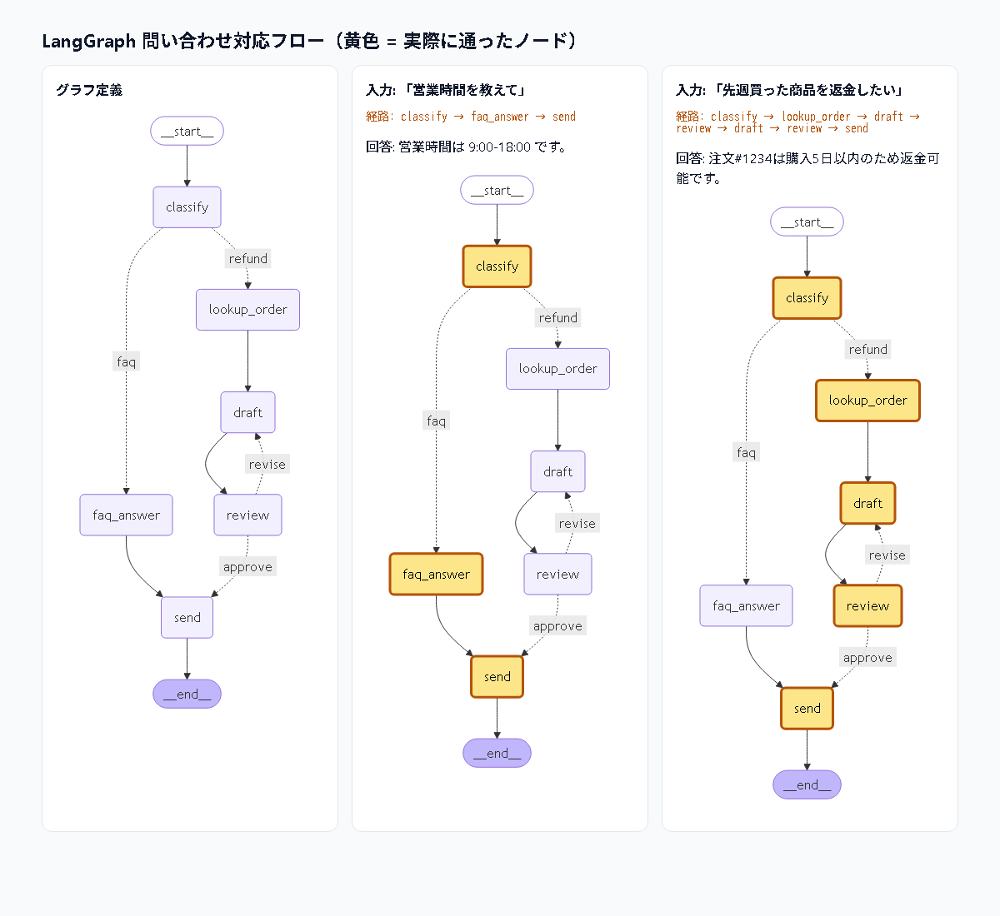
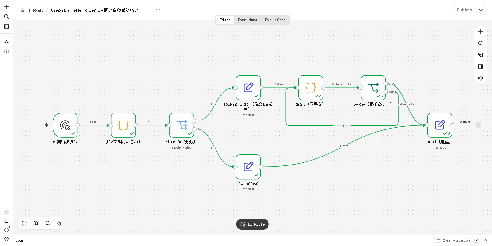

# Introduction to Harness / Loop / Graph Engineering

[日本語](README.md) | **English**

Teaching material for three key design perspectives in AI agent development, each experienced through a **~1-minute demo**.

> **Note:** The demo output and the detailed documents under `docs/` are in Japanese.
> If you use Claude Code (see below), you can ask in English and get explanations in English.

| # | Topic | In a nutshell | Demo |
|---|---|---|---|
| 1 | [Harness Engineering](docs/01_harness_engineering.md) | Design the **system around the model** (validation, permissions, retries, logging) | `demos/harness_demo.py` |
| 2 | [Loop Engineering](docs/02_loop_engineering.md) | Design the **try → verify → fix** iteration and its stop conditions | `demos/loop_demo.py`<br>`demos/loop_vs_langgraph_demo.py` (the same loop written in LangGraph, for comparison) |
| 3 | [Graph Engineering](docs/03_graph_engineering.md) | Design the workflow as a graph of **nodes, edges, and state** | `demos/graph_demo.py`<br>`demos/langgraph_demo.py` (LangGraph + LangChain version, with visualization) |
| 4 | [Graph Engineering and GUI tools](docs/04_graph_tools.md) | Dify / Copilot Studio / n8n are **tools for drawing graphs in a GUI** | `gui/n8n/support_flow.json` (GUI version running on free n8n) |

```
 Graph (structure)  ┌─ classify ─▶ draft ─▶ review ─┐
                    │                 ▲        │    │
 Loop (iteration)   │                 └─revise─┘    ▼
                    │                              send
 Harness (wrapper)  └ wraps each node's model call with validation, permissions, and retries
```

## Run with Claude Code (recommended)

Start Claude Code in the cloned folder and just ask in natural language. It runs the demo and explains the results.

```bash
git clone https://github.com/GochaLearningSpace/harness-loop-graph.git
cd harness-loop-graph
claude
```

On first launch, when asked whether you trust this folder, choose **Yes** (otherwise the permissions in `.claude/settings.json` are not applied).

Example requests:
- "Show me the harness demo"
- "Run the demo that shows the difference between a loop and LangGraph" (LangGraph is installed automatically)
- "Show me all of them in order"
- Slash commands such as `/demo harness` and `/demo langgraph` also work

Configuration files:
- `CLAUDE.md` … demo catalog, how to run each demo, how to explain the results
- `.claude/settings.json` … allows the exact demo commands (exact match only) to run without a confirmation prompt.
  Setup steps such as `pip install` still ask for confirmation, for safety
- `.claude/skills/demo/SKILL.md` … the `/demo` command

## Run manually

Requirements: **Python 3.9+ only** (no external libraries, no API key)
\* The LangGraph versions additionally need Python 3.10+ and the packages in `requirements-langgraph.txt`

```bash
# Run individually (paced for presentations)
python demos/harness_demo.py
python demos/loop_demo.py
python demos/graph_demo.py

# Run all three in a row (press Enter to go to the next one)
python demos/run_all.py

# Show everything at once without pauses
python demos/run_all.py --fast
```

### LangGraph + LangChain versions (graph visualization)

```bash
python -m venv .venv
.venv\Scripts\activate            # macOS/Linux: source .venv/bin/activate
pip install -r requirements-langgraph.txt

python demos/loop_vs_langgraph_demo.py   # while loop vs. LangGraph (diagram, history, resume)
python demos/langgraph_demo.py --open    # opens a diagram in the browser with the executed path highlighted
```

`langgraph_demo.py` prints an ASCII graph and a per-node execution trace in the terminal, and writes a Mermaid diagram to `output/langgraph_flow.html`.
In the diagram, the nodes actually visited for each input are highlighted in yellow. No API key is needed here either.



### GUI version (n8n, free, no API key)

```bash
docker run -it --rm -p 5678:5678 n8nio/n8n     # or with Node.js 24.x: npx n8n (Node.js 26 does not work)
```

Open http://localhost:5678, import `gui/n8n/support_flow.json`, and press **Execute**.


See [docs/04_graph_tools.md](docs/04_graph_tools.md) for detailed steps and a talk track.

> For reproducibility, the "model" in the demos is a fake model that answers from a script.
> It produces the same result every time, so it is safe to use in workshops and training sessions.
> If you replace it with a real LLM (such as the Claude API), the harness, loop, and graph structures stay the same.

## Suggested session plan (~10 minutes)

| Time | Content |
|---|---|
| 0:00 | Intro: "Agent performance = model × the design around it" |
| 1:00 | Harness: explanation (1 min) → demo (1 min) |
| 3:00 | Loop: explanation (1 min) → demo (1 min) |
| 5:00 | Graph: explanation (1 min) → demo (1 min) |
| 7:00 | Wrap-up: how the three relate (loops live inside the graph, a harness wraps each node) |
| 8:00 | Q&A |

Each document includes **talking points (a talk track)** and **code highlights**.

## Repository layout

```
.
├── README.md                  # Japanese
├── README.en.md               # English (this file)
├── CLAUDE.md                  # instructions for Claude Code
├── .claude/                   # Claude Code settings and the /demo skill
├── docs/
│   ├── 01_harness_engineering.md
│   ├── 02_loop_engineering.md
│   ├── 03_graph_engineering.md
│   ├── 04_graph_tools.md      # relation to Dify / Copilot Studio / n8n
│   └── images/
├── demos/
│   ├── _common.py             # colored output and pacing
│   ├── harness_demo.py
│   ├── loop_demo.py
│   ├── graph_demo.py          # minimal hand-written graph engine (standard library only)
│   ├── langgraph_demo.py      # LangGraph + LangChain version (visualization)
│   ├── loop_vs_langgraph_demo.py  # while loop vs. LangGraph
│   └── run_all.py
├── gui/
│   └── n8n/support_flow.json  # GUI workflow to import into n8n
└── requirements-langgraph.txt
```

## Hands-on exercises (optional)
1. **Harness**: change to `ALLOWED_RISK = {"read", "write"}`, run it, and see what happens
2. **Loop**: check whether it still passes after adding `(([1, 2],), 1.5)` to `TESTS`, and what happens with `max_iters=1`
3. **Graph**: add a `cancel` route for cancellation requests and confirm that it shows up in the Mermaid diagram
