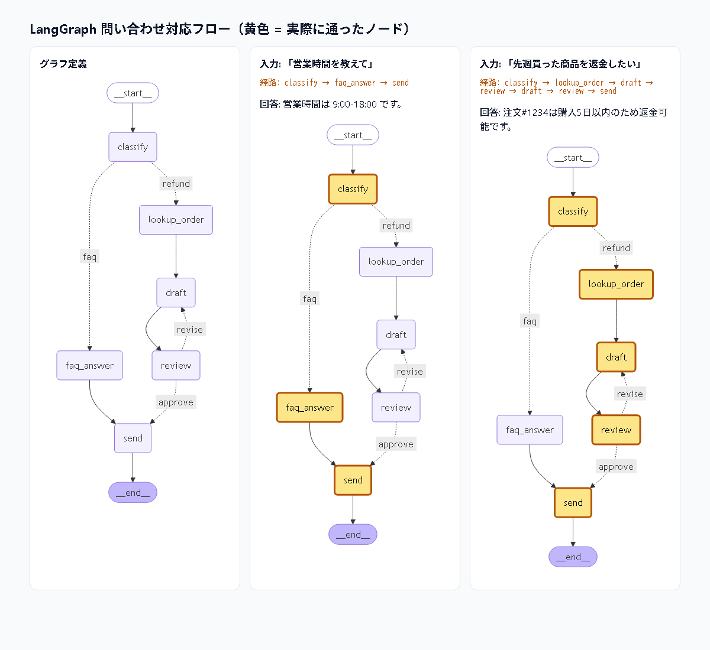
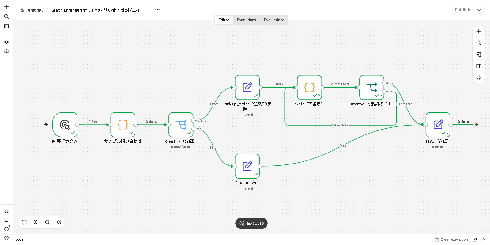

# Harness / Loop / Graph Engineering 入門

AI エージェント開発で重要な3つの設計観点を、**各1分程度のデモ**で体験する教材です。

| # | テーマ | ひとことで | デモ |
|---|---|---|---|
| 1 | [Harness Engineering](docs/01_harness_engineering.md) | モデルの**周りの仕組み**（検証・権限・リトライ・ログ）を設計する | `demos/harness_demo.py` |
| 2 | [Loop Engineering](docs/02_loop_engineering.md) | **試す→検証→直す** の反復と停止条件を設計する | `demos/loop_demo.py`<br>`demos/loop_vs_langgraph_demo.py`（同じループを LangGraph で書いた比較版） |
| 3 | [Graph Engineering](docs/03_graph_engineering.md) | 処理フローを**ノード・エッジ・状態**のグラフで設計する | `demos/graph_demo.py`<br>`demos/langgraph_demo.py`（LangGraph + LangChain 版・見える化） |
| 4 | [Graph Engineering と GUI ツール](docs/04_graph_tools.md) | Dify / Copilot Studio / n8n などは**グラフを GUI で描く道具** | `gui/n8n/support_flow.json`（無料の n8n で動かす GUI 版） |

```
 Graph（構造）   ┌─ classify ─▶ draft ─▶ review ─┐
                 │                 ▲        │    │
 Loop（反復）    │                 └─revise─┘    ▼
                 │                              send
 Harness（器）   └ 各ノードのモデル呼び出しを 検証・権限・リトライ で包む
```

## Claude Code で動かす（おすすめ）

clone したフォルダで Claude Code を起動し、自然言語で頼むだけでデモを実行・解説します。

```bash
git clone https://github.com/GochaLearningSpace/harness-loop-graph.git
cd harness-loop-graph
claude
```

初回起動時に「このフォルダを信頼しますか」と聞かれたら **Yes** を選んでください（信頼しないと `.claude/settings.json` の許可設定が効きません）。

依頼の例:
- 「ハーネスのデモを見せて」
- 「ループと LangGraph の違いが分かるデモを動かして」（LangGraph のインストールも自動で行います）
- 「全部順番に見せて」
- `/demo harness`、`/demo langgraph` などのスラッシュコマンドも使えます

設定ファイル:
- `CLAUDE.md` … デモ一覧、実行方法、説明の仕方
- `.claude/settings.json` … 各デモの実行コマンド（決め打ちの完全一致のみ）を確認なしで実行できるよう許可。
  `pip install` などのセットアップは安全のため毎回確認が出ます
- `.claude/skills/demo/SKILL.md` … `/demo` コマンド

## 動かし方（手動）

必要なもの: **Python 3.9+ のみ**（外部ライブラリ・API キー不要）
※ LangGraph 版のみ Python 3.10+ と `requirements-langgraph.txt` のインストールが必要です

```bash
# 個別に実行（発表用のテンポで表示）
python demos/harness_demo.py
python demos/loop_demo.py
python demos/graph_demo.py

# 3つ続けて実行（Enter で次へ）
python demos/run_all.py

# 待ち時間なしで一気に表示
python demos/run_all.py --fast
```

### LangGraph + LangChain 版（グラフの見える化）

```bash
python -m venv .venv
.venv\Scripts\activate            # macOS/Linux: source .venv/bin/activate
pip install -r requirements-langgraph.txt

python demos/langgraph_demo.py --open   # 実行後、通過経路を色付けした図をブラウザで開く
```

ターミナルに ASCII のグラフ図とノードごとの実行トレースを表示し、`output/langgraph_flow.html` に Mermaid 図を出力します。
図では、入力ごとに実際に通ったノードが黄色で表示されます。こちらも API キーは不要です。



### GUI 版（n8n・無料・API キー不要）

```bash
docker run -it --rm -p 5678:5678 n8nio/n8n     # または Node.js 24 系で: npx n8n（26 は不可）
```

http://localhost:5678 を開き、`gui/n8n/support_flow.json` をインポートして **Execute** を押すだけです。


手順と台本は [docs/04_graph_tools.md](docs/04_graph_tools.md) を参照してください。

> デモの「モデル」は、再現性のため台本どおりに応答する Fake モデルです。
> 毎回同じ結果になるので、説明会・研修でも安心して使えます。
> 本物の LLM（Claude API など）に差し替えても、ハーネス・ループ・グラフの構造はそのまま使えます。

## 進め方の例（約10分）

| 時間 | 内容 |
|---|---|
| 0:00 | 導入: 「エージェントの性能 = モデル × 周りの設計」 |
| 1:00 | Harness: 説明（1分）→ デモ（1分） |
| 3:00 | Loop: 説明（1分）→ デモ（1分） |
| 5:00 | Graph: 説明（1分）→ デモ（1分） |
| 7:00 | まとめ: 3つの関係（Graph の中に Loop、各ノードに Harness） |
| 8:00 | 質疑 |

各ドキュメントに **「話すポイント（台本）」** と **「コードの見どころ」** を載せています。

## ファイル構成

```
.
├── README.md
├── docs/
│   ├── 01_harness_engineering.md
│   ├── 02_loop_engineering.md
│   ├── 03_graph_engineering.md
│   ├── 04_graph_tools.md       # Dify / Copilot Studio / n8n との関係
│   └── images/
├── demos/
│   ├── _common.py         # 色付き出力・テンポ調整
│   ├── harness_demo.py
│   ├── loop_demo.py
│   ├── graph_demo.py      # 自作ミニエンジン版（標準ライブラリのみ）
│   ├── langgraph_demo.py  # LangGraph + LangChain 版（見える化）
│   ├── loop_vs_langgraph_demo.py  # while ループと LangGraph の比較
│   └── run_all.py
├── gui/
│   └── n8n/support_flow.json  # n8n にインポートする GUI 版ワークフロー
└── requirements-langgraph.txt
```

## ハンズオン課題（任意）
1. **Harness**: `ALLOWED_RISK = {"read", "write"}` に変えて実行し、何が起きるか確認する
2. **Loop**: `TESTS` に `(([1, 2],), 1.5)` を追加しても通るか、`max_iters=1` にするとどうなるか確認する
3. **Graph**: 「解約」の問い合わせを扱う `cancel` ルートを追加し、Mermaid 図に反映されることを確認する
