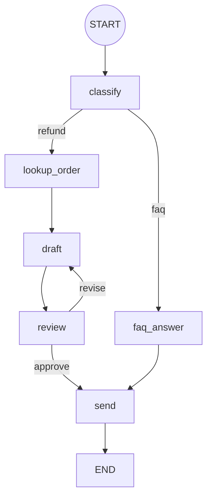
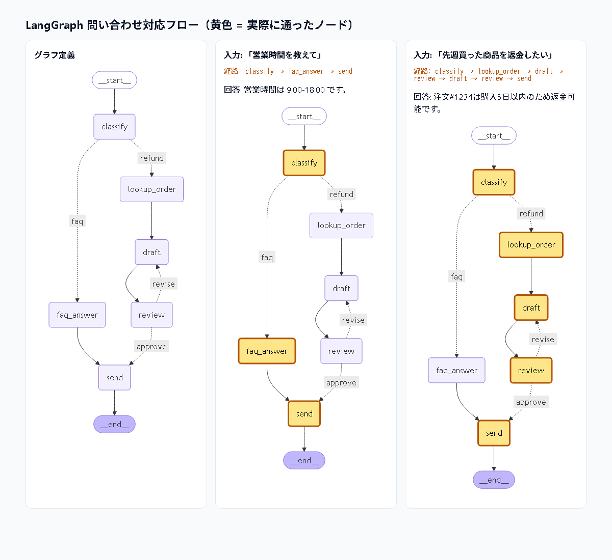

# 3. Graph Engineering（グラフ・エンジニアリング）

## ひとことで
**AI の処理フローを「ノード（処理）・エッジ（遷移）・状態（State）」のグラフとして設計すること。**

1つの巨大なプロンプトや自由なエージェントに任せるのではなく、
「どの順で・どの条件で・どこに戻るか」を明示的な構造として表現する。


（↑ デモが実際に出力する図）

## 構成要素

| 要素 | 意味 | デモでの例 |
|---|---|---|
| ノード | 1つの処理単位（LLM 呼び出し・ツール・普通の関数） | `classify`, `draft`, `review` |
| エッジ | 次にどこへ行くか | `lookup_order → draft` |
| 条件付きエッジ（ルーター） | 状態を見て分岐 | `classify` が faq / refund を振り分け |
| サイクル | 差し戻し・再試行 | `review -- revise --> draft` |
| 共有状態 | ノード間で受け渡すデータ | `{"query", "kind", "answer", "revisions", ...}` |

## 3つの関係
- **Harness** = 1回のモデル呼び出しを安全・確実にする「器」
- **Loop** = 検証しながら繰り返す「時間方向」の設計
- **Graph** = 複数の処理・ループを組み合わせる「構造方向」の設計
  （グラフのサイクルはループそのもの。各ノードの中にハーネスがある）

## なぜ重要か
- **予測可能性**: 自由なエージェントより挙動が読める。業務フローに向く
- **可視化・デバッグ**: どのノードを通ったかがトレースで分かる
- **部品化・テスト**: ノード単位で差し替え・単体テストができる
- **制御**: 人間の承認ノード、並列実行、チェックポイントからの再開を入れやすい
- LangGraph、Claude Agent SDK のワークフロー、n8n / Dify などがこの考え方

## デモ（約1分）
```bash
python demos/graph_demo.py
```

**シナリオ**: カスタマーサポートの問い合わせ対応フロー

| 入力 | 通ったパス |
|---|---|
| 「営業時間を教えて」 | classify → faq_answer → send（3ステップ） |
| 「先週買った商品を返金したい」 | classify → lookup_order → draft → review(NG) → draft → review(OK) → send（7ステップ） |

### 話すポイント（台本）
1. 最初に表示される Mermaid 図 → 「処理の流れがデータとして定義されている」
2. FAQ 入力 → 「ルーターが短い経路を選んだ」
3. 返金入力 → 「レビューで NG → **差し戻しエッジ** で draft に戻り、根拠付きの回答に改善」
4. 締め: **フローを図として持つと、分岐・差し戻し・可視化・テストが簡単になる**

### コードの見どころ
- `Graph` クラス（約40行）… LangGraph の核心部分の最小実装
- ノードは「状態の差分」を返す → `state = {**state, **diff}`
- `max_steps` … グラフにサイクルがあるので無限ループ防止（= Loop Engineering の停止条件）
- `revisions >= 3` で強制 approve … 差し戻し回数の上限

## LangGraph + LangChain 版（見える化）

同じフローを本物のフレームワークで実装した版です。

```bash
pip install -r requirements-langgraph.txt
python demos/langgraph_demo.py --open
```

| 見える化 | 方法 |
|---|---|
| ターミナルの ASCII 図 | `app.get_graph().draw_ascii()`（grandalf を使用） |
| ノードごとの実行トレース | `app.stream(..., stream_mode="updates")` で各ノードが返した状態の差分を表示 |
| ブラウザでの図 | `draw_mermaid()` の定義に、**実際に通ったノードの黄色ハイライト**を追記して `output/langgraph_flow.html` に出力 |
| PNG（任意） | `--png` を付けると `draw_mermaid_png()` で出力（外部 API mermaid.ink にグラフ定義を送信） |



### 自作エンジン版との対応

| 自作 (`graph_demo.py`) | LangGraph (`langgraph_demo.py`) |
|---|---|
| `Graph()` | `StateGraph(SupportState)`（`TypedDict` で状態の型を定義） |
| `@g.node("draft")` | `g.add_node("draft", draft)` |
| `g.edge(a, b)` | `g.add_edge(a, b)` |
| `g.conditional(src, router, mapping)` | `g.add_conditional_edges(src, router, mapping)` |
| `g.run(state, start=...)` | `g.compile()` → `app.invoke()` / `app.stream()` |
| `max_steps` | `recursion_limit`（既定 25） |
| 自作 `mermaid()` | `app.get_graph().draw_mermaid()` / `draw_ascii()` / `draw_mermaid_png()` |

### LangChain が担う部分
各ノードの中の LLM 呼び出しは LangChain の **LCEL チェーン** `prompt | model | parser` で書いています。

```python
classify_chain = ChatPromptTemplate.from_messages([...]) | FakeListChatModel(responses=[...]) | StrOutputParser()
```

`FakeListChatModel` は台本どおりに答える LangChain 標準のテスト用モデルです。
`langchain-anthropic` の `ChatAnthropic(model="claude-sonnet-5-5")` などに差し替えれば、グラフはそのままで実モデルを使うようになります。

- **LangChain** = 1つのノードの中身（プロンプト・モデル・パーサーの部品化）
- **LangGraph** = ノード同士のつなぎ方（状態・分岐・サイクル・可視化）

### 話すポイント（台本）
1. ASCII 図 → 「`get_graph()` だけで構造が図になる」
2. stream のトレース → 「各ノードが状態のどこを更新したかが1行ずつ見える」
3. ブラウザ（`--open`）→ 同じグラフでも、入力ごとに通る経路（黄色）が違うことを見せる
4. 締め: **自作版と同じ考え方。フレームワークを使うと図・トレース・再開などが最初から付いてくる**

## 発展
- Dify / Copilot Studio / n8n などの GUI ツールとの関係と、GUI 版デモは [04_graph_tools.md](04_graph_tools.md) を参照
- 並列ノード（fan-out / fan-in）で調査タスクを同時実行
- `review` を人間の承認ノードにする（Human-in-the-loop）
- 状態をチェックポイント保存して、途中から再開できるようにする
