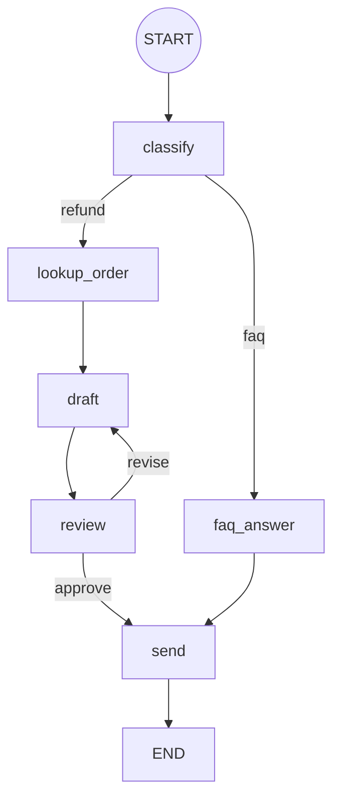

# 3. Graph Engineering（グラフ・エンジニアリング）

## ひとことで
**AI の処理フローを「ノード（処理）・エッジ（遷移）・状態（State）」のグラフとして設計すること。**

1つの巨大なプロンプトや自由なエージェントに任せるのではなく、
「どの順で・どの条件で・どこに戻るか」を明示的な構造として表現する。


（↑ デモが実際に出力する図）

## 構成要素

| 要素 | 意味 | デモでの例 |
|---|---|---|
| ノード | 1つの処理単位（LLM 呼び出し・ツール・普通の関数） | `classify`, `draft`, `review` |
| エッジ | 次にどこへ行くか | `lookup_order → draft` |
| 条件付きエッジ（ルーター） | 状態を見て分岐 | `classify` が faq / refund を振り分け |
| サイクル | 差し戻し・再試行 | `review -- revise --> draft` |
| 共有状態 | ノード間で受け渡すデータ | `{"query", "kind", "answer", "revisions", ...}` |

## 3つの関係
- **Harness** = 1回のモデル呼び出しを安全・確実にする「器」
- **Loop** = 検証しながら繰り返す「時間方向」の設計
- **Graph** = 複数の処理・ループを組み合わせる「構造方向」の設計
  （グラフのサイクルはループそのもの。各ノードの中にハーネスがある）

## なぜ重要か
- **予測可能性**: 自由なエージェントより挙動が読める。業務フローに向く
- **可視化・デバッグ**: どのノードを通ったかがトレースで分かる
- **部品化・テスト**: ノード単位で差し替え・単体テストができる
- **制御**: 人間の承認ノード、並列実行、チェックポイントからの再開を入れやすい
- LangGraph、Claude Agent SDK のワークフロー、n8n / Dify などがこの考え方

## デモ（約1分）
```bash
python demos/graph_demo.py
```

**シナリオ**: カスタマーサポートの問い合わせ対応フロー

| 入力 | 通ったパス |
|---|---|
| 「営業時間を教えて」 | classify → faq_answer → send（3ステップ） |
| 「先週買った商品を返金したい」 | classify → lookup_order → draft → review(NG) → draft → review(OK) → send（7ステップ） |

### 話すポイント（台本）
1. 最初に表示される Mermaid 図 → 「処理の流れがデータとして定義されている」
2. FAQ 入力 → 「ルーターが短い経路を選んだ」
3. 返金入力 → 「レビューで NG → **差し戻しエッジ** で draft に戻り、根拠付きの回答に改善」
4. 締め: **フローを図として持つと、分岐・差し戻し・可視化・テストが簡単になる**

### コードの見どころ
- `Graph` クラス（約40行）… LangGraph の核心部分の最小実装
- ノードは「状態の差分」を返す → `state = {**state, **diff}`
- `max_steps` … グラフにサイクルがあるので無限ループ防止（= Loop Engineering の停止条件）
- `revisions >= 3` で強制 approve … 差し戻し回数の上限

## 発展
- 並列ノード（fan-out / fan-in）で調査タスクを同時実行
- `review` を人間の承認ノードにする（Human-in-the-loop）
- 状態をチェックポイント保存して、途中から再開できるようにする
