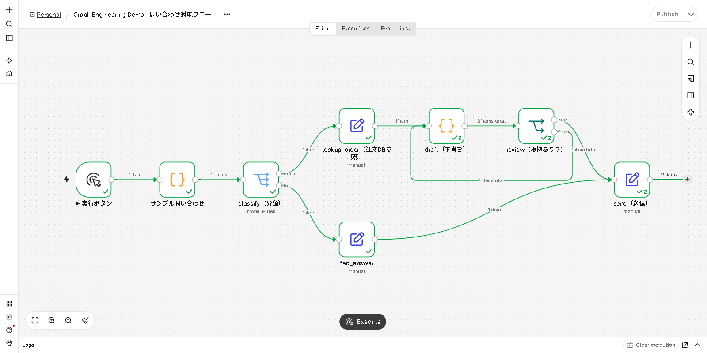

# 4. Graph Engineering と GUI ツール（Dify / Copilot Studio / n8n など）

## ひとことで
**Dify や Copilot Studio のワークフロー画面は「グラフを GUI で描く道具」です。**
LangGraph でコードに書いている「ノード・エッジ・状態」を、マウスでつないでいるだけで、考え方は同じです。

```
           Graph Engineering（設計の考え方：ノード・エッジ・状態・分岐・ループ）
                                  │
        ┌─────────────────────────┼──────────────────────────┐
     コードで書く              GUI で描く（OSS/無料枠あり）       GUI で描く（企業向け SaaS）
   LangGraph など            Dify / n8n / Langflow / Flowise    Copilot Studio / Power Automate
```

## 概念の対応表

| Graph Engineering の概念 | LangGraph（コード） | Dify | Microsoft Copilot Studio | n8n |
|---|---|---|---|---|
| グラフ全体 | `StateGraph` | Workflow / Chatflow | エージェントのトピック、エージェントフロー | Workflow |
| ノード（処理） | `add_node()` | LLM・Code・HTTP Request などのノード | メッセージ・質問・アクションなどのノード | 各種ノード（Code, HTTP, AI Agent など） |
| 条件付きエッジ（分岐） | `add_conditional_edges()` | IF/ELSE、Question Classifier（LLM による分類） | 条件ノード、トピックへのリダイレクト | IF、Switch |
| 状態（State） | `TypedDict` の状態 | 変数（会話変数・ノード出力） | 変数（トピック変数・グローバル変数） | 各ノードを流れるデータ（item の JSON） |
| ループ・差し戻し | サイクルのエッジ | Loop / Iteration ノード | トピック内の条件と移動、フローのループ処理 | 前のノードへ戻る接続、Loop Over Items |
| 実行の見える化 | `stream()`、`draw_mermaid()` | 実行ログ・トレース画面 | テストパネル、分析画面 | 実行履歴（通ったノードに件数が表示される） |
| 定義の書き出し | Python コード | DSL（YAML）のエクスポート | ソリューションとしてエクスポート | JSON のエクスポート／インポート |

> 製品の画面名や機能は更新が速いので、細かい名称は各公式ドキュメントで確認してください。

## 何を選ぶか

| ツール | 向いている場面 | 費用（2026年11月時点の目安。正確な条件は公式で要確認） |
|---|---|---|
| **LangGraph** | 細かい制御、テスト、Git 管理をしたい開発者 | OSS（無料） |
| **Dify** | LLM アプリ（RAG、チャットボット）を素早く GUI で作る | Community 版のセルフホストは無料。クラウドの無料枠は「Sandbox」 |
| **n8n** | 業務システム連携（Slack、Google、DB）に AI を組み込む | Community 版のセルフホストは無料（fair-code ライセンス） |
| **Langflow / Flowise** | LangChain の部品を GUI でつなぐ試作 | OSS（無料） |
| **Copilot Studio** | Microsoft 365 / Teams / Power Platform を中心とした社内エージェント | 有料（クレジットによる従量課金）。統制・セキュリティ機能が強い |

### GUI とコードの使い分け
- **GUI が強い**: 全体の流れが一目で分かる、非エンジニアと一緒に作れる、既存の連携ノードがすぐ使える
- **コードが強い**: 複雑な状態管理、単体テスト、レビュー（差分が読める）、細かいエラー処理
- **実務でよくある形**: GUI で流れを素早く試作 → 安定したら重要な部分をコード（LangGraph など）に移す。
  逆に、コードで作った処理を API にして GUI ツールから呼び出す形もよくあります。

### GUI でも Harness と Loop は必要
GUI で描いても、設計の勘所は同じです。
- **Harness**: 各 LLM ノードの出力形式の指定、検証ノード、エラー時の分岐（Dify・n8n はノード単位でエラー処理やリトライを設定可能）
- **Loop**: 差し戻しループには必ず**上限回数**を付ける（このデモでは `revisions >= 3` で強制的に抜ける）

---

## GUI デモ（n8n、無料・API キー不要、約1分）

他のデモと**まったく同じ問い合わせ対応フロー**を、n8n の画面で動かします。
LLM は使わず、分類は Switch ノード、下書きは Code ノードで台本どおりに動くので、API キーもアカウントも不要です。



### 準備（初回のみ、どちらか一方）

**A. Docker がある場合（推奨）**
```bash
docker run -it --rm -p 5678:5678 n8nio/n8n
```

**B. Node.js がある場合**
```bash
node --version   # v24.x であることを確認
npx n8n
```
> **Node.js は 24 系を使ってください。** n8n 2.x は Node.js 24 以上が必要ですが、Windows の Node.js 26 では
> 依存パッケージ（`@confluentinc/kafka-javascript`）のビルド済みバイナリがなく、インストールに失敗しました（2026年11月時点で確認）。
> winget の場合: `winget install --id OpenJS.NodeJS.LTS --version 24.22.1`
> 初回は約2,300パッケージをダウンロードするため、**20分前後かかることがあります**。研修で使う場合は事前に済ませておいてください。
> また n8n 2.x では、コンテナ外での実行は「非推奨」と表示されます（デモには支障ありません）。

起動したらブラウザで http://localhost:5678 を開き、最初に表示されるオーナーアカウント作成画面で、ローカル用のアカウントを作ります（ローカル保存のみ）。

### デモ手順
1. 新規ワークフローを作り、ワークフロー名の横の `…` メニューから **Import from File** を選んで [`gui/n8n/support_flow.json`](../gui/n8n/support_flow.json) を読み込む
   （ファイルの中身をコピーして、キャンバスに Ctrl+V で貼り付けても読み込めます）
2. 画面下中央の **Execute** ボタンを押す
3. 通ったノードと線が緑色になり、ノードに `✓2`（2回実行）、線に `1 item` などの件数が表示されるので、それを見せる

> n8n のバージョンによってボタン名やメニューの位置が少し違うことがあります。上の画像は n8n 2.45.4 の画面です。

### 話すポイント（台本）
1. 画面を見せて「LangGraph で書いたのと**同じグラフ**を、GUI で描いたもの」
2. `classify（分類）` の出力 → 「refund に1件、faq に1件。**条件付きエッジ**」
3. `review（根拠あり？）` の false から `draft（下書き）` に戻る線 → 「**差し戻しのループ**。1回目は NG で戻り、2回目で OK」
   （`draft` と `review` に `✓2` と表示され、2回実行されたことが分かる）
4. `send（送信）` をクリックして出力を開く → 2件とも回答が入っている
5. 締め: **ツールが変わっても、設計しているのは「ノード・エッジ・状態」。Graph Engineering の考え方はそのまま使える**

### 本物の LLM に置き換えるには
- `classify（分類）` → n8n の **Text Classifier** ノードや **AI Agent** ノード（Dify なら Question Classifier）
- `draft（下書き）` → **Basic LLM Chain** などの LLM ノード
- どちらも LLM プロバイダーの認証情報（API キー）が必要になります

### 同じフローを Dify で作る場合の対応
| このデモのノード | Dify のノード |
|---|---|
| サンプル問い合わせ | Start（入力変数 `query`） |
| classify（分類） | Question Classifier（FAQ / 返金 の2クラス） |
| faq_answer | LLM または Template |
| lookup_order | HTTP Request / Code（注文 API を呼ぶ） |
| draft → review → 差し戻し | Loop ノードの中に LLM（下書き）と IF/ELSE（検証）、ループ上限回数を設定 |
| send | End / Answer |
